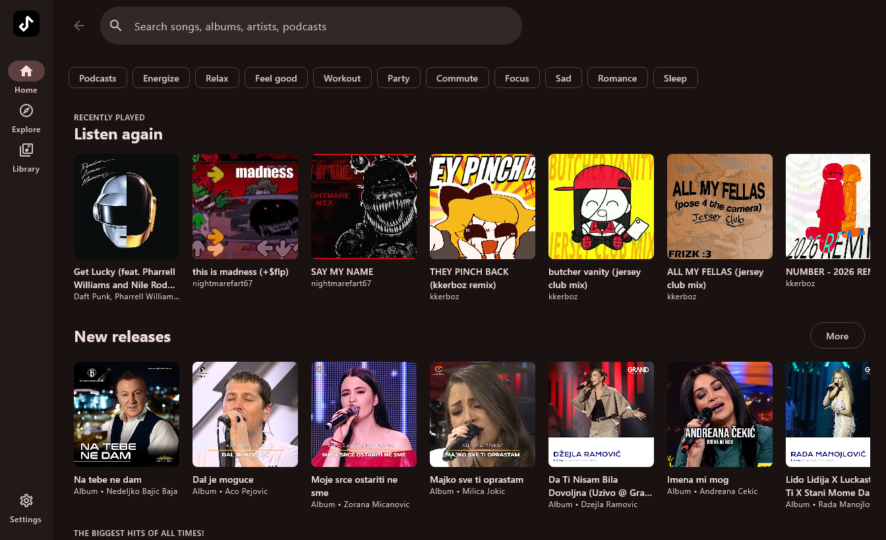
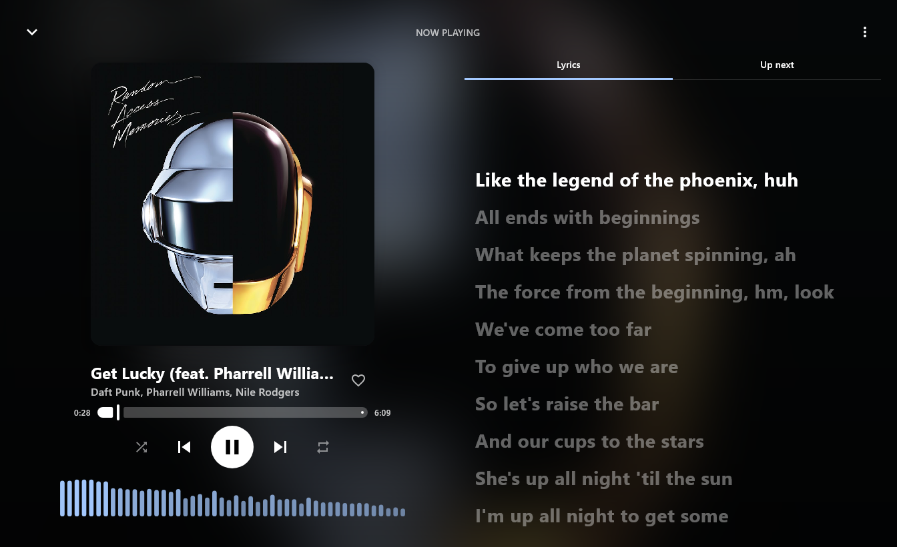
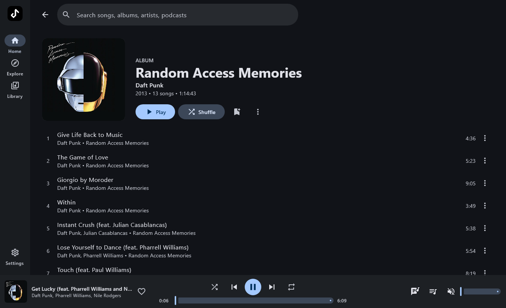
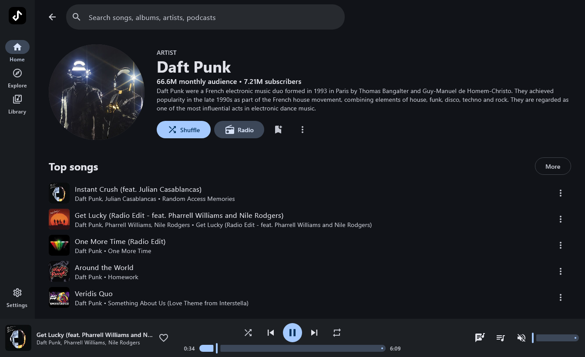
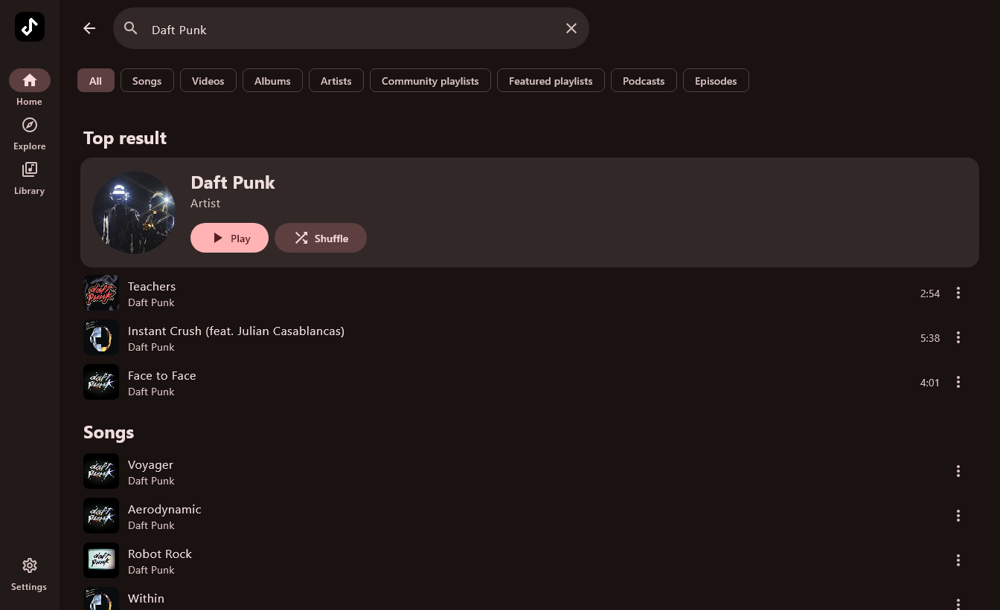
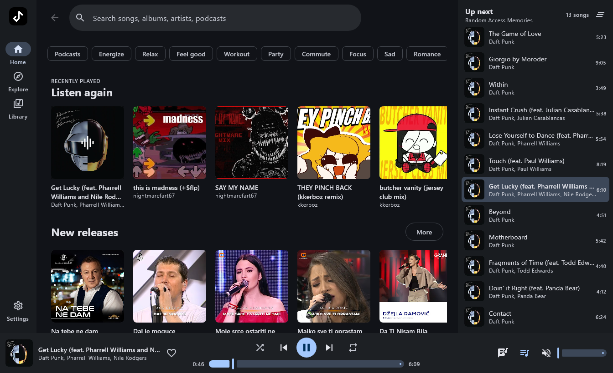
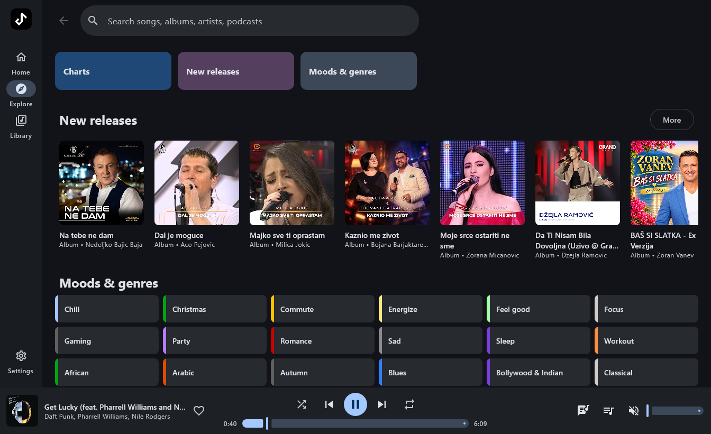
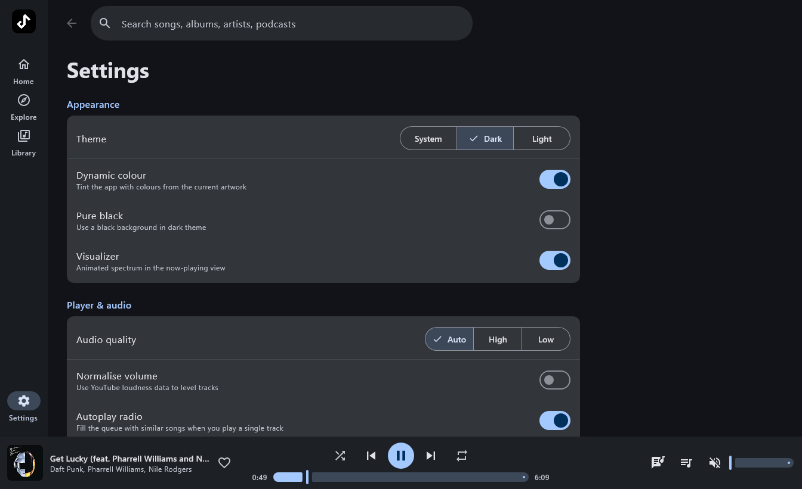

<div align="center">


# Metrolist PC

### YouTube Music client for Windows, macOS and Linux

<br/>

[](https://github.com/aleksa07/Metrolist-PC/releases)
[](https://github.com/aleksa07/Metrolist-PC/blob/desktop/LICENSE)
[](https://github.com/aleksa07/Metrolist-PC/releases)

<br/>

[**Download**](#download-now) · [**Features**](#features) · [**Build**](#build-from-source) · [**Credits**](#special-thanks)

</div>

> [!NOTE]
> Metrolist PC is a desktop port of [Metrolist](https://github.com/MetrolistGroup/Metrolist), the open-source YouTube Music client for Android. It reuses Metrolist's YouTube Music, Last.fm and lyrics code and rebuilds the interface for the desktop.

> [!WARNING]
> **Regional Restriction** - If YouTube Music is unavailable in your region, this app will not work without a **VPN or proxy** connecting to a supported region.

---

<div align="center">

<h1><a id="screenshots"></a>Screenshots</h1>










</div>

---

<div align="center">

<h1><a id="features"></a>Features</h1>

<table>
  <tr>
    <td width="50%" valign="top">

#### Playback
- Stream any song or video from YouTube Music
- Radio / autoplay queue for any song, artist or playlist
- Seek, shuffle, repeat, queue reordering
- Media keys, tray controls and keyboard shortcuts

</td>
    <td width="50%" valign="top">

#### Audio
- High / auto / low audio quality
- Audio normalization
- Live spectrum visualizer

</td>
  </tr>
  <tr>
    <td width="50%" valign="top">

#### Lyrics & Discovery
- Live synced lyrics from LRCLIB, BetterLyrics, KuGou and YouTube Music
- Personalized quick picks and mood filters
- Charts, new releases, moods & genres
- Search songs, albums, artists, videos, playlists and podcasts

</td>
    <td width="50%" valign="top">

#### Library & Account
- Liked songs, local playlists and listening history
- Save albums, artists and playlists
- Google sign-in for your YouTube Music account
- Your YouTube Music playlists

</td>
  </tr>
  <tr>
    <td width="50%" valign="top">

#### Social
- Last.fm scrobbling, now playing and loves
- Discord Rich Presence

</td>
    <td width="50%" valign="top">

#### Interface
- Built with Material 3 and Compose Multiplatform
- Dynamic colour from the album art
- Light / Dark / Pure black themes
- Dark title bar on Windows

</td>
  </tr>
</table>

</div>

---

<div align="center">

<h1><a id="download-now"></a>Download Now</h1>

<table>
  <tr>
    <th align="center">Windows</th>
    <th align="center">macOS</th>
    <th align="center">Linux</th>
  </tr>
  <tr>
    <td align="center"><a href="https://github.com/aleksa07/Metrolist-PC/releases/latest/download/Metrolist-PC-Windows.msi"><b>Metrolist-PC-Windows.msi</b></a></td>
    <td align="center"><a href="https://github.com/aleksa07/Metrolist-PC/releases/latest/download/Metrolist-PC-macOS.dmg"><b>Metrolist-PC-macOS.dmg</b></a></td>
    <td align="center"><a href="https://github.com/aleksa07/Metrolist-PC/releases/latest/download/Metrolist-PC-Linux.deb"><b>Metrolist-PC-Linux.deb</b></a></td>
  </tr>
</table>

<h3>All versions are on the <a href="https://github.com/aleksa07/Metrolist-PC/releases">releases page</a>.</h3>

</div>

> [!TIP]
> The installers are not code-signed. On Windows, if SmartScreen says "Windows protected your PC", click **More info → Run anyway**. On macOS, right-click the app and choose **Open** the first time.

---

<div align="center">

<h1><a id="build-from-source"></a>Build From Source</h1>

</div>

Requires JDK 17 or newer (Gradle downloads JDK 21 for the build automatically).

```bash
cd desktop
./gradlew run             # start the app
./gradlew packageMsi      # Windows installer (packageDmg on macOS, packageDeb on Linux)
./gradlew smokeTest       # end-to-end check: search, stream, decode and seek
```

Pushing a tag such as `v1.0.1` runs the [Desktop release](.github/workflows/desktop-release.yml) workflow, which builds all three installers and publishes them as a GitHub release.

---

<div align="center">

<h1><a id="special-thanks"></a>Special Thanks</h1>

<h3>Metrolist PC stands on the shoulders of incredible open-source work.</h3>

<table>
  <thead>
    <tr>
      <th align="center">Project</th>
      <th align="center">Contribution</th>
    </tr>
  </thead>
  <tbody>
    <tr>
      <td align="center"><a href="https://github.com/MetrolistGroup/Metrolist"><strong>Metrolist</strong></a></td>
      <td>The original Android app by <a href="https://github.com/mostafaalagamy">Mo Agamy</a> and contributors: YouTube Music API layer, Last.fm and lyrics clients</td>
    </tr>
    <tr>
      <td align="center"><a href="https://github.com/MetrolistGroup/innertubex"><strong>InnerTubeX</strong></a></td>
      <td>Stream extraction and player cipher handling</td>
    </tr>
    <tr>
      <td align="center"><strong>InnerTune</strong> · <strong>OuterTune</strong></td>
      <td>The projects Metrolist grew from</td>
    </tr>
    <tr>
      <td align="center"><a href="https://better-lyrics.boidu.dev"><strong>Better Lyrics</strong></a> · <a href="https://lrclib.net"><strong>LRCLIB</strong></a></td>
      <td>Time-synced lyrics</td>
    </tr>
    <tr>
      <td align="center"><a href="https://github.com/ZemerTeam/zemer-cipher"><strong>zemer-cipher</strong></a></td>
      <td>YouTube cipher deobfuscation</td>
    </tr>
    <tr>
      <td align="center"><a href="https://github.com/bytedeco/javacv"><strong>JavaCV / FFmpeg</strong></a> · <a href="https://www.jetbrains.com/compose-multiplatform/"><strong>Compose Multiplatform</strong></a></td>
      <td>Audio decoding and the desktop UI toolkit</td>
    </tr>
  </tbody>
</table>

<h3>If you enjoy Metrolist, consider <a href="https://github.com/MetrolistGroup/Metrolist#support-the-project">supporting the original project</a>.</h3>

</div>

---

<div align="center">

<h1>Disclaimer</h1>

This project is **not affiliated with, funded, authorized, endorsed by, or in any way associated** with YouTube, Google LLC, Metrolist Group LLC, or any of their affiliates and subsidiaries.

All trademarks, service marks, and intellectual property rights referenced in this project belong to their respective owners.

Licensed under the [GNU GPL v3](LICENSE), like Metrolist.

</div>

---

<div align="center">

<br/>

**Desktop port by [aleksa07](https://github.com/aleksa07) · Original Metrolist by [Mo Agamy](https://github.com/mostafaalagamy)**

</div>
